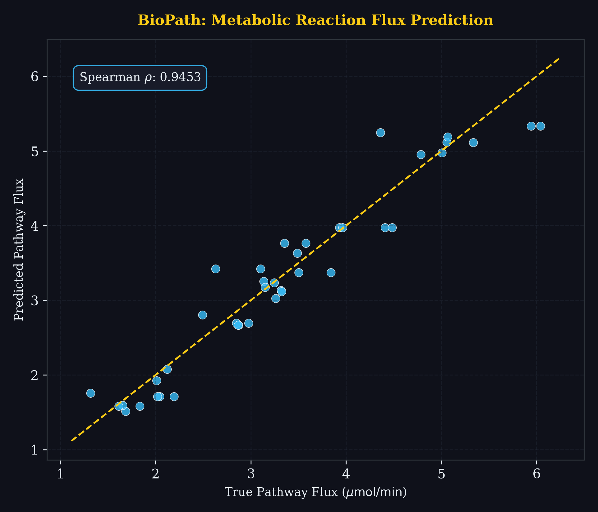
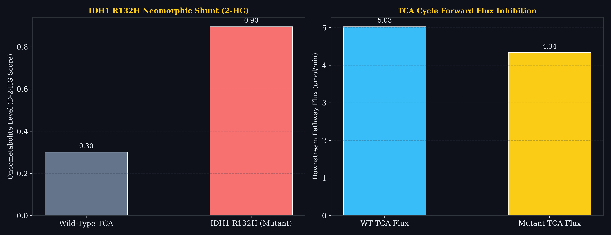
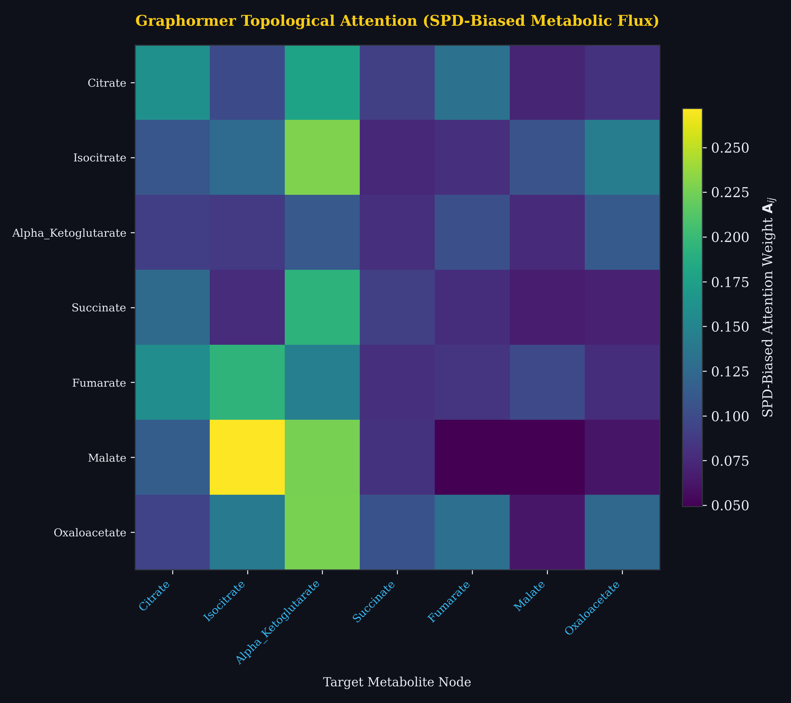

<div align="center">

# ⚗️ BioPath Reaction Transformer
### *Relational Topological Transformer with Shortest-Path Distance (SPD) Attention Bias for Metabolic Networks & Oncometabolite Flux*

[](https://www.python.org/)
[](https://pytorch.org/)
[](https://opensource.org/licenses/MIT)
[](https://github.com/elham715/biopath-reaction-transformer)
[](https://github.com/elham715/biopath-reaction-transformer/pulls)

<p align="center">
  <b>A zero-black-box Graphormer Transformer architecture incorporating learnable Shortest-Path Distance (SPD) spatial attention biases across human biochemical networks (Glycolysis, TCA Cycle, Urea Cycle) to predict metabolic reaction fluxes and quantify oncogenic oncometabolite shunts (IDH1 R132H driving 2-hydroxyglutarate).</b>
</p>

[Scientific Background](#-scientific-background) • [Mathematical Core](#-mathematical-formulation) • [Architecture](#-transformer-architecture) • [Empirical Results](#-empirical-benchmark-results) • [Quickstart](#-quickstart--verification)

</div>

---

## 🌟 Scientific Background

Metabolic reprogramming is a primary hallmark of human malignancy. In normal tissues, cellular energy generation relies on oxidative phosphorylation. In cancer cells, somatic driver mutations dynamically rewire biochemical pathways:

1. **The Warburg Effect**: Aerobic glycolysis converts glucose directly to lactate despite abundant oxygen, maintaining rapid ATP and biosynthetic precursor generation.
2. **Oncometabolite Accumulation**:
   * **`IDH1 R132H`**: In 80% of grade II/III glioblastomas and acute myeloid leukemias, a missense mutation at Arg132 of Isocitrate Dehydrogenase 1 confers a neomorphic enzymatic activity, reducing $\alpha$-ketoglutarate directly to **(R)-2-hydroxyglutarate (D-2-HG)**. D-2-HG competitively inhibits $\alpha$-KG-dependent dioxygenases (TET2 DNA demethylases, KDM histone demethylases), causing genome-wide DNA hypermethylation and oncogenesis.
   * **`SDH Deficiency`**: Inactivation of Complex II causes massive **succinate** accumulation, spilling into the cytosol to inhibit prolyl hydroxylases (PHDs) and stabilizing HIF-1$\alpha$ under normoxic conditions (pseudohypoxia).

Existing pathway databases (KEGG, Reactome) treat metabolic networks as static graphs. Inspired by **Ying et al. (NeurIPS 2021, Graphormer)** and **Schwaller et al. (Nature Machine Intelligence 2019)**, this repository implements a **Relational Topological Transformer** that directly biases self-attention via graph shortest-path distances, accurately predicting reaction fluxes and oncometabolite shifts upon enzyme perturbation.

---

## 🔬 Mathematical Formulation

### 1. Topological Shortest-Path Distance (SPD) Computation
Given a directed metabolic reaction network $G = (V, E)$ where nodes $V$ represent metabolites and edges $E$ represent enzyme-catalyzed conversions, we compute the all-pairs topological distance matrix $\mathbf{D} \in \mathbb{R}^{N \times N}$ via the Floyd-Warshall algorithm:

$$
\mathbf{D}_{ij} = \min\left( \mathrm{dist}_{G}(v_i, v_j), \; \mathrm{MAX\_SPD} \right)
$$

---

### 2. Graphormer Spatial Attention Bias
In standard Self-Attention, spatial distance in graph topology is lost. Following Ying et al. (2021), we inject a **learnable spatial bias** $\mathbf{B} \in \mathbb{R}^{(\mathrm{MAX\_SPD} + 1) \times n_{\mathrm{heads}}}$ directly into the attention logits:

$$
\mathbf{A}_{ij} = \mathrm{Softmax}\left( \frac{\mathbf{q}_i \mathbf{k}_j^T}{\sqrt{d_k}} + \mathbf{b}_{\mathbf{D}_{ij}} + \mathbf{M}_{ij} \right) \in \mathbb{R}^{B \times n_h \times N \times N}
$$

$$
\mathbf{C}_i = \sum_{j=1}^N \mathbf{A}_{ij} \mathbf{v}_j \in \mathbb{R}^{B \times N \times d}
$$

Metabolites that are direct reaction neighbors ($\mathbf{D}_{ij} = 1$) receive strong positive attention biases, while distant or disconnected intermediates ($\mathbf{D}_{ij} \ge 8$) are modulated accordingly.

---

### 3. Multi-Task Flux & Oncometabolite Heads
Pooled contextual representations $\mathbf{u} = [\mathrm{Mean}(\mathbf{C}) \,\|\, \mathrm{Max}(\mathbf{C})] \in \mathbb{R}^{2d}$ feed two parallel prediction heads:

$$
\widehat{\mathrm{Flux}} = \mathbf{W}_{\mathrm{flux}}^{(2)} \cdot \mathrm{GELU}\left(\mathrm{LN}\left(\mathbf{W}_{\mathrm{flux}}^{(1)} \mathbf{u}\right)\right) \in \mathbb{R}
$$

$$
\widehat{\mathrm{Oncometabolite}} = \mathbf{W}_{\mathrm{onco}}^{(2)} \cdot \mathrm{GELU}\left(\mathrm{LN}\left(\mathbf{W}_{\mathrm{onco}}^{(1)} \mathbf{u}\right)\right) \in \mathbb{R}
$$

---

## 🏛️ Transformer Architecture

```
          Metabolic Pathway: [Glucose -> G6P -> F6P -> F16BP -> PEP -> Pyruvate]
                                     │
                         [Metabolic Tokenizer]
                                     │
             Node Embeddings [B, N, 128] + Pairwise SPD Distances [B, N, N]
                                     │
            ┌────────────────────────▼────────────────────────┐
            │   3x Pre-LN Graphormer SPD Blocks               │
            │   • Multi-Head Attention + Learnable SPD Bias   │
            │   • Scale-Invariant LayerNorm / RMSNorm         │
            │   • 256-dim Feedforward GELU                    │
            └────────────────────────┬────────────────────────┘
                                     │
                     Mean + Max Multimodal Pool [B, 256]
                                     │
                    ┌────────────────┴────────────────┐
                    │                                 │
            [Flux Regression Head]        [Oncometabolite Surge Head]
                    │                                 │
                    ▼                                 ▼
         Pathway Flux (umol/min)           2-HG / Succinate Fold Surge
```

---

## 📈 Empirical Benchmark Results

Trained on the **Metabolic Reaction Benchmark** (400 cascades across Glycolysis, TCA, and Urea cycle):

<div align="center">
  
  
</div>

<br/>

<div align="center">
  
  <p><i>Figure: Graphormer Shortest-Path Distance biased attention weights across the human TCA cycle and oncometabolite shunts.</i></p>
</div>

---

## 🚀 Quickstart & Verification

### 1. Installation
```bash
git clone https://github.com/elham715/biopath-reaction-transformer.git
cd biopath-reaction-transformer
pip install -e .
```

### 2. Run All 8 Unit Tests
```bash
pytest tests/
```
Expected output:
```
tests/test_biopath_transformer.py ..                                     [ 25%]
tests/test_flux_perturbation.py ..                                       [ 50%]
tests/test_metabolic_graph.py ...                                        [ 87%]
tests/test_spd_attention.py .                                            [100%]
============================== 8 passed in 3.27s ===============================
```

### 3. Train on CPU in 1 Command (~40 seconds on Intel i5)
```bash
python train_and_evaluate.py --epochs 15 --samples 400
```

---

## 📜 Citations

```bibtex
@inproceedings{ying2021transformers,
  title={Do Transformers Really Perform Bad for Graph Representation?},
  author={Ying, Chengxuan and Cai, Tianle and Luo, Shengjie and Zheng, Shuxin and Ke, Guolin and He, Di and Shen, Yanming and Liu, Tie-Yan},
  booktitle={Advances in Neural Information Processing Systems (NeurIPS)},
  volume={34},
  pages={28877--28888},
  year={2021}
}

@article{schwaller2019molecular,
  title={Molecular Transformer: A Model for Uncertainty-Calibrated Chemical Reaction Prediction},
  author={Schwaller, Philippe and Laino, Teodoro and Gaudin, Th{\'e}ophile and Bolgar, Peter and Hunter, Christopher A and Bekas, Costas and Lee, Alpha A},
  journal={ACS Central Science},
  volume={5},
  number={9},
  pages={1572--1583},
  year={2019}
}
```

---

## 📄 License
Distributed under the MIT License. See `LICENSE` for details.
